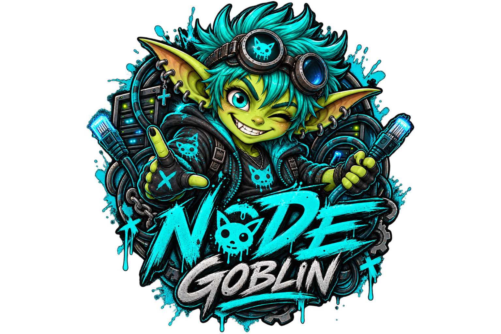

# Node Goblin

<p align="center">
  
</p>

Node Goblin lets Burrow agents run commands and work with files on other machines.

- **Node Goblin** is the mod installed on your Burrow controller. It manages host connections, pairing, and agent assignments.
- **Mini Node Goblin** is the small runtime installed on each execution host. It connects outbound to the controller over TLS. You do not need a full Burrow installation on each host.

“Mini” only distinguishes the host runtime; it uses the same Node Goblin protocol.

## Before you start

You need:

- A working Burrow installation that supports the `execution-provider-v1` mod capability.
- A **Linux host with systemd**, **Node.js 24.x** available to the service, and **Python 3** for the host pairing command.
- Root/sudo access on the host, plus `curl`, `tar`, `sha256sum`, and standard Linux installation/account utilities.
- A controller address and TLS port reachable from the host. The default port is **7443**.
- OpenSSL on the controller if Node Goblin will generate its TLS certificate automatically.

The packaged installer targets Linux/systemd. See the [installation guide](docs/installation.md) for package details and alternatives.

> Pairing gives Burrow access to run processes and read or change files as the host's `burrow` service account. Choose hosts and accounts you trust. A workspace path is a working location, not a sandbox.

## Quick start

### 1. Install the mod on your Burrow controller

Install into the `mods` directory of the Burrow runtime you actually use:

```bash
BURROW_RUNTIME_ROOT="${BURROW_RUNTIME_ROOT:-${XDG_DATA_HOME:-$HOME/.local/share}/burrow}"
mkdir -p "$BURROW_RUNTIME_ROOT/mods"
git clone https://github.com/GoblinKing-Burrow/Node-Goblin.git \
  "$BURROW_RUNTIME_ROOT/mods/node-goblin"
```

Restart Burrow to load the mod. The manifest declares the Core-owned `execution-provider-v1` capability; no separate environment grant is required.

### 2. Enable the controller listener

In Burrow, open **Node Goblin → Controller & TLS**:

1. Enable the controller.
2. Set the bind host to an interface the execution host can reach.
3. Choose the TLS port, save, and restart Burrow.

The listener is **disabled by default** and defaults to `127.0.0.1:7443`. Loopback only works for connections from the same machine. For remote hosts, use a reachable interface and restrict access to the port with your firewall/network policy.

If no TLS key and certificate are configured, Node Goblin generates them using OpenSSL. See [configuration](docs/configuration.md) for your own certificates and CA trust.

### 3. Install and start Mini Node Goblin on the execution host

This command downloads and runs Burrow's bootstrap installer as root. Review the script first, or use the [selected-release installation procedure](docs/installation.md#install-mini-node-goblin) if you want to inspect and pin a package.

```bash
curl -fsSL https://raw.githubusercontent.com/GoblinKing-Burrow/Burrow/main/install-node-goblin.sh | sudo sh
```

The package installer creates or adopts the `burrow` account and installs the service. It does not start it until you connect.

Replace the example controller address and host ID below with your own:

```bash
sudo node-goblin configure controller.example:7443 worker-01
sudo node-goblin connect
sudo node-goblin pairing-code
```

Use a unique, stable host ID beginning with a letter or digit; letters, digits, dots, underscores, and hyphens are suitable. Avoid the reserved ID `local`.

### 4. Compare and approve the pairing

For the default first-time pairing flow:

1. In Burrow's **Pending pairings**, find the same host ID.
2. Compare its code with `sudo node-goblin pairing-code` on the host through a trusted channel.
3. On the host, confirm the exact matching code:

   ```bash
   sudo node-goblin confirm-pairing CODE
   ```

4. Approve the intended host in Burrow. Reject unexpected requests.
5. Check that it appears approved and connected.

Use the current code: reconnecting can create a new pairing transcript. Controller approval alone is insufficient for a new host without an explicitly configured CA. For CA-verified pairing or existing shared-secret deployments, follow the [pairing guide](docs/pairing.md).

### 5. Assign an agent and verify it

In **Node Goblin → Agent assignments**:

1. Choose **Configured gateway** for the agent.
2. Select the approved host.
3. Enter an absolute workspace path on that host that the `burrow` account can access.
4. Save the assignment.

Assignments apply to **future turns**. Start a new turn with a harmless command or file read in a disposable workspace, then check the returned host identity, working directory, and result.

An active systemd service only means the daemon is running. Verify pairing, connection, and actual execution separately.

## Everyday operation

Run these on the execution host:

```bash
sudo node-goblin status
sudo journalctl -u burrow-host-gateway.service -n 100 --no-pager
```

Configuration and installed files:

- `/etc/burrow-host-gateway/gateway.env`: controller address, host ID, and optional enrollment/TLS settings
- `/var/lib/burrow-host-gateway`: persistent identity, controller trust, pairing state, and operation journal
- `/opt/burrow-host-gateway`: installed runtime
- `burrow-host-gateway.service`: systemd service, running as `burrow`

Keep secrets in the protected configuration file, never in command arguments or URLs. Protect state backups and logs; they can contain credentials, pairing codes, command output, or file contents.

`configure` saves settings without restarting a running daemon. After draining active work, apply saved changes with:

```bash
sudo node-goblin apply --restart
```

`connect` starts/enables the service but does not restart an already-running daemon. See the [command reference](docs/cli.md) for unpairing and other commands.

## Updating and uninstalling

**Controller mod:** review the incoming revision, update the checkout, then restart Burrow.

```bash
BURROW_RUNTIME_ROOT="${BURROW_RUNTIME_ROOT:-${XDG_DATA_HOME:-$HOME/.local/share}/burrow}"
git -C "$BURROW_RUNTIME_ROOT/mods/node-goblin" pull --ff-only
```

**Host runtime:** drain active work and stop the service, make a protected backup of configuration and state, install the selected replacement package, then start and verify it. The installer preserves configuration and state. Follow the [upgrade procedure](docs/operations.md#upgrade-procedure).

**Uninstall the host runtime:**

```bash
sudo node-goblin uninstall
```

This stops/removes the service and installed program. It **preserves** the `burrow` account, configuration, identity/trust, and operation journal for reinstall. It does not purge credentials or remove the controller-side mod.

## Troubleshooting and documentation

- **Active service, no connection:** check the controller is enabled, restarted, and reachable on the configured interface/port.
- **Pairing is stuck:** compare the current code on both sides, confirm on the host, and approve the matching live request in Burrow.
- **Certificate or identity changed:** investigate the change and follow the re-pairing procedure rather than bypassing trust checks.
- **Connection dropped during work:** the host operation may continue. Check its outcome before retrying side effects.

For detailed help:

- [Installation](docs/installation.md) · [Pairing and assignments](docs/pairing.md)
- [Operations and recovery](docs/operations.md) · [Security](docs/security.md)
- [Configuration](docs/configuration.md) · [Commands](docs/cli.md)
- [Filesystem operations and traversal limits](docs/filesystem.md)
- [Architecture, APIs, and developer guide](docs/index.md)
- [Build the documentation locally](docs/development.md#documentation-setup)

## Links

- [Burrow](https://github.com/GoblinKing-Burrow/Burrow)
- [Releases](https://github.com/GoblinKing-Burrow/Node-Goblin/releases)
- [Issues](https://github.com/GoblinKing-Burrow/Node-Goblin/issues)
