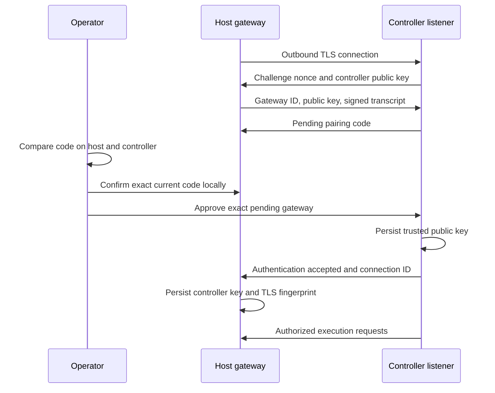

# Pairing and agent assignment

Pairing establishes permission for a controller to execute on a host. Treat approval as a host-access decision. A successful TLS socket or a visible pending gateway is not approval.

## First connection with key pairing

<div class="diagram-scroll" role="region" tabindex="0" aria-label="Scrollable architecture diagram" markdown="1">



</div>

*On narrow screens, scroll the diagram horizontally to read all labels.*

1. Configure the controller and restart BURROW after listener/TLS changes.
2. Configure and start the host as described in [installation](installation.md).
3. Read the current code using `sudo node-goblin pairing-code` on the host.
4. In **Pending pairings**, locate the same gateway ID and compare the displayed code through an independently trusted channel.
5. On the host, run `sudo node-goblin confirm-pairing CODE` with the exact independently compared code. First no-CA trust requires this local confirmation; controller approval alone cannot enable host execution. Confirmation applies only to the current connection transcript.
6. Approve only the intended host in BURROW. Reject unexpected requests.
7. Confirm the gateway appears approved and connected, then perform a harmless test in a disposable workspace.

The node creates an Ed25519 keypair in `node-identity.json`. The v2 transcript binds the nonce, gateway ID, node public key, controller public key, and SHA-256 fingerprint of the controller TLS certificate DER bytes. The host hashes its peer certificate and the listener hashes its own socket certificate; neither trusts a fingerprint supplied in a protocol message. The signature and comparison code cover the same transcript. The displayed code is 12 hexadecimal characters grouped as `XXXX-XXXX-XXXX`. An unpaired node without an explicit CA temporarily permits an unauthenticated TLS channel for bootstrap. For controlled networks, provision `BURROW_GATEWAY_CA_FILE` before the first connection so standard TLS verification also applies from the outset.

An explicitly configured CA provides controller authentication through standard TLS verification instead of local confirmation. Do not install an untrusted CA to bypass confirmation.

After initial key pairing, the node persists the controller public key and certificate fingerprint. A changed controller key/certificate is not automatically accepted. Plan certificate replacement and re-pairing rather than treating a mismatch as a transient connectivity problem.

## Pending and restored requests

Controller trust mutations have one serialized owner. Durable mutation intents block uncertain identities on restart after interrupted writes, including rollback failure. Revoke and re-pair an uncertain identity instead of manually clearing its intent.

At most 256 pending identities are retained in memory and durable settings. New identities are refused when full (`pending_pairings_full`); reject unwanted requests to free capacity. Reconnection of an existing pending identity remains possible. Pending gateway/controller IDs must be 1–255 ASCII letters, digits, dots, underscores or hyphens, begin with a letter/digit, and not be `local`; public keys must be Ed25519 PEM and at most 1024 characters. Restored collections discard invalid entries, remove unrecognized fields and retain only the last 256 unique valid IDs. Pending sockets do not create permanent disconnected health records.

Pending request records can survive a controller restart for visibility, but approval requires the matching live connection, nonce, public key, and connection generation. At most 256 valid pending records are retained. Wait for the node to reconnect and verify its current code. Pending records do not carry a pairing-expiry timestamp; the UI may show a dash. The transport has a 60-second default authentication timeout, so a reconnect can replace the live nonce and code. Read and compare the current code again if confirmation or approval becomes stale.

### Upgrade compatibility

New pairing requires the `tls-cert-sha256` channel-binding feature on **both** peers, including when an explicit CA is installed. Stripping that feature or omitting locally observed certificate bytes fails closed; there is no v1 retry for new pairing. Upgrade host and controller before enrolling a new host.

Already approved Ed25519 identities without the persisted `channelBinding` marker retain v1 reconnect compatibility with older peers, using their existing controller-key/certificate pins. New pairings persist the marker on both sides and cannot reconnect with an unbound transcript. Upgrading alone does not claim to retrofit channel binding into existing trust: verified unpair/re-pair establishes that guarantee. Legacy HMAC proof and CA verification are unchanged.

## Legacy shared-secret enrollment

The repository also supports HMAC enrollment for existing deployments:

- Register the gateway ID and shared secret through the protected BURROW settings interface. Leave the controller ID as `controller` for a new packaged CLI enrollment: that CLI uses this fixed default and exposes no controller-ID environment setting. Programmatic enrollment can use another controller ID only when the host's stored trust and controller record agree.
- Restart BURROW after saving HMAC trust so the listener loads it.
- Provision the same enrollment token out of band in the host's protected environment file, never in a command argument or URL.
- Provide appropriate TLS CA trust for the controller. HMAC enrollment does not use the key-pairing bootstrap exception.
- Verify successful authentication, then remove the bootstrap token from the environment file. New HMAC trust is saved when enrollment is initialized; the running first-enrollment transport records consumption on authentication. Explicit host unpairing also records consumption.

`controller-trust.json` retains the shared secret for subsequent authentication. An existing trust file takes precedence over a changed enrollment token, so editing the environment token alone does not rotate that saved credential. “One-time enrollment” does not mean that file contains no reusable credential. New key-paired deployments and existing HMAC deployments have different trust state; do not assume changing a UI field migrates between methods. Coordinate any migration with a backup and a verified unpair/re-pair procedure.

## Assign an agent

In **Agent assignments**:

1. Choose **Configured gateway**.
2. Select the approved gateway ID.
3. Enter an absolute workspace root on that host.
4. Save the assignment.

The UI sends a Core-owned agent update shaped as:

```json
{
  "executionEnvironment": {
    "kind": "remote",
    "providerId": "node-goblin",
    "targetId": "worker-01",
    "workspaceRoot": "/srv/burrow/workspaces/example"
  }
}
```

No extra per-agent Node Goblin capability approval is required after the installed provider is admitted and the host is paired. Assignment selects where future turns execute; Core retains its normal execution policy.

Assignments apply to future turns. Core owns when and how an assignment is admitted; the model does not select a different host mid-turn through this UI. An absolute workspace is a location, not confinement of process or filesystem access.

To return an agent to the controller, choose **Local controller** and an absolute local workspace, then save. The local assignment omits provider and target IDs.

## Revoke and unpair

Controller-side **Revoke** removes the persisted gateway record and secrets and asks the listener to remove/disconnect that identity. Follow the returned restart guidance. A socket disconnect is not evidence that already-started host processes have stopped; inspect and stop them separately when required.

Host-side `sudo node-goblin unpair` stops the service and verifies it is inactive before changing trust. If stopping fails or the service remains active, it refuses the trust removal. On success it removes controller trust, pairing-code, and local confirmation state, removes controller pins from the preserved node identity, and records enrollment consumption. It preserves the node's keypair and operation journal. Configure the intended controller, reconnect, and compare a new code.

### Recover from a changed controller or stuck pairing

1. Investigate an unexpected key/certificate change before accepting it. Confirm the intended controller address and identity with its operator.
2. Drain work and inspect any uncertain host operations before stopping or restarting services.
3. Revoke the gateway in BURROW when old authorization should be removed; follow any returned restart guidance.
4. Run `sudo node-goblin unpair` on the host and require it to succeed. Do not delete trust files manually to bypass a failed service-stop check.
5. If necessary, run `sudo node-goblin configure controller.example:7443 worker-01` for the intended endpoint. An explicitly configured CA must also match the intended controller.
6. Run `sudo node-goblin connect`, compare the fresh code, confirm it locally, and approve the matching live request. Verify a harmless operation before resuming work.

Unpairing preserves the host keypair and journal. Do not remove `node-identity.json` or the whole state directory as a routine pairing fix: that loses identity or replay evidence. A stale enrollment token cannot silently restore old trust after explicit unpairing because the enrollment-consumed marker is retained.

Do not clone the same durable node identity onto several concurrently running hosts. Give each host its own state directory and stable gateway ID.

## Source references

- [`gateway/lib/pairing.mjs`](https://github.com/GoblinKing-Burrow/Node-Goblin/blob/main/gateway/lib/pairing.mjs)
- [`gateway/lib/network-transport.mjs`](https://github.com/GoblinKing-Burrow/Node-Goblin/blob/main/gateway/lib/network-transport.mjs)
- [`gateway/lib/controller-listener.mjs`](https://github.com/GoblinKing-Burrow/Node-Goblin/blob/main/gateway/lib/controller-listener.mjs)
- [`server/index.mjs`](https://github.com/GoblinKing-Burrow/Node-Goblin/blob/main/server/index.mjs)
- [`ui/settings.js`](https://github.com/GoblinKing-Burrow/Node-Goblin/blob/main/ui/settings.js)
- [`gateway/deploy/node-goblin`](https://github.com/GoblinKing-Burrow/Node-Goblin/blob/main/gateway/deploy/node-goblin)
