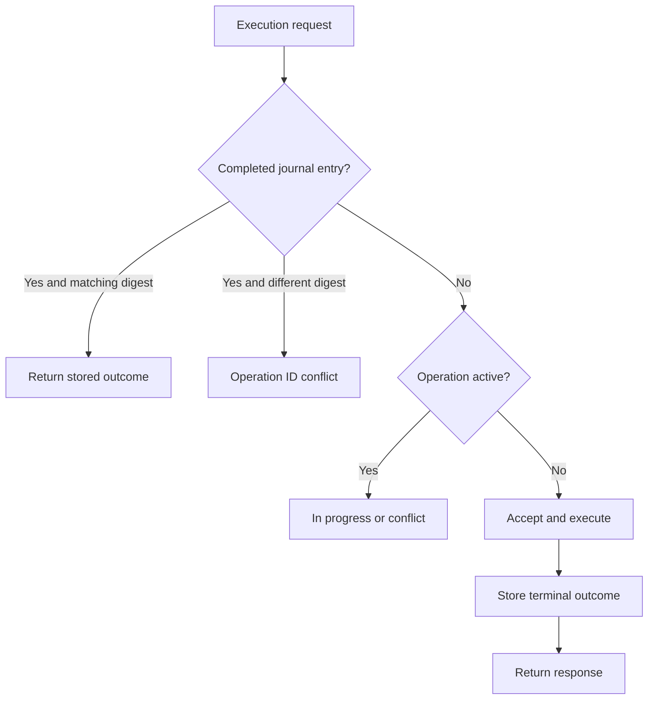

# Wire protocol and process execution

*On narrow screens, swipe tables horizontally to see every column.*

The daemon accepts one JSON request per line and emits JSON lines. Protocol version is `1.0`. It can run over local stdio or over the authenticated outbound TLS connection. These are application envelopes rather than a claim of JSON-RPC compatibility.

## Request and response shapes

```json
{"id":"request-1","method":"hello","params":{}}
```

```json
{"type":"response","requestId":"request-1","ok":true,"result":{"name":"burrow-host-gateway","protocolVersion":"1.0","transport":"stdio-jsonl","host":{"hostname":"worker-1","platform":"linux","addresses":[{"interface":"en0","interfaceKind":"lan-candidate","family":"IPv4","address":"192.0.2.10"}]}}}
```

`requestId` correlates a transport request. `operationId` identifies execution for deduplication/replay and must be kept stable across a safe retry of the same operation. They serve different purposes.

| Method | Parameters | Result |
| --- | --- | --- |
| `hello` | None | Name, implementation version, protocol version, transport, current host metadata |
| `health` | None | Status and active operation IDs |
| `telemetry.configure` | `{enabled, endpoint?, headers?, destinations?}` | Validated in-memory telemetry configuration status |
| `process.exec` | Operation ID and process options | Accepted envelope, stream/terminal events, terminal response |
| `filesystem.execute` | Operation ID, tool, arguments | Accepted envelope and terminal filesystem result |
| `cancel` | `operationId` | `{operationId, cancelling}`; cancellation request is not terminal evidence |
| `shutdown` | None | Idle-daemon administrative/development stop; complete active operations first |

`hello.result.host` is sampled from the gateway OS for each hello request (stdio or authenticated network application request): `{hostname: string|null, platform: string|null, addresses: [{interface, interfaceKind, family, address}]}`. `family` is `IPv4` or `IPv6`; `interfaceKind` is `lan-candidate`, `container`, `vpn`, or `unknown`, inferred from interface **names** only. Hostname/platform and interface names/IPs are validated and bounded; internal/loopback entries and MAC addresses are omitted. At most 32 interface names and 64 addresses are reported. The list is an observed local snapshot, **not** a chosen primary route, assurance of LAN membership, or promise any listed address is reachable from Core. Docker and VPN addresses may be present; verify topology and reachability independently. No periodic heartbeat or automatic polling is implied.

Malformed JSON produces an `invalid_json` protocol error. Unsupported methods produce `unknown_method`. Network authentication messages are handled by the transport before daemon dispatch.

After authentication, Core may send `telemetry.configure` with a legacy scalar transport or a resolved `destinations` array. Each destination has a stable ID, enabled state, HTTP base or exact trace URL, private headers, `http/json` or `http/protobuf` protocol, trace enablement, and independent TLS verification/CA configuration. Gateways emit traces, not Core's metrics. Destinations have independent bounded queues, export failure/rejected-span counters and shutdown; a failed collector never changes remote operation outcomes. OTLP partial successes preserve numeric rejection counts without logging collector text or retrying accepted spans.

Configuration applies to future admissions. Already-admitted operations finish through their original generation. Core also supplies a private `telemetryConfiguration` on authenticated process/filesystem envelopes so a new operation from an older run retains that run's original destinations after replacement or disable. This field is not public process input: it is stripped before execution, replay digests, journal/correlation storage, and result projections. Omitting it preserves older-controller behavior. A host environment endpoint remains authoritative independently of Core's master switch; credentials are not forwarded between distinct endpoint owners.

Trusted environment-owned snapshots may contain per-signal resolved CA/client certificate/client key PEMs, never host file paths. Generic and trace-specific environment headers merge case-insensitively with trace-specific values winning. Missing selected TLS material disables that signal rather than falling back to an untrusted connection. Public status excludes endpoint/auth/PEM values. Both the controller mod and host gateway must be upgraded for the new private per-operation transport.

Core may include a validated `traceContext` object containing W3C version-00 `traceparent` and optional `tracestate` on `process.exec` and `filesystem.execute`. The controller and gateway both validate it and forward it only as transport context. It is excluded from derived operation IDs, controller correlation, and gateway replay/idempotency digests, and it is removed before child-process or filesystem-runner invocation. When telemetry is enabled through Core Settings or an optional host override, Node Goblin emits one bounded remote server span joined to Core's tool span. The sampled flag and trace state are preserved; an unsampled remote parent executes normally without export. Only validated operation kind/tool/target/operation identifiers are attributes. Commands, arguments, working directories, environment/protected values, filesystem paths/content/queries/output, and raw errors are never exported. Collector failure never changes operation outcome.

Use `shutdown` only after active operations have completed. For packaged deployments, use the systemd service lifecycle to stop the daemon; do not rely on this protocol method to drain or cancel active work.

## Process options

Choose exactly one execution form:

```json
{"operationId":"demo-001","executable":"node","args":["-e","console.log('hello')"],"cwd":"/srv/burrow/workspaces/example","timeoutMs":30000}
```

or a shell command string. `command` uses `shell: true`; `executable` with an array of string `args` uses `shell: false`. A command cannot also supply an executable or a nonempty args array.

| Option | Behavior |
| --- | --- |
| `cwd` | Requested working directory; otherwise daemon working directory |
| `env` | String-coerced environment additions over the daemon environment |
| `timeoutMs` | Positive integer; default 30,000 ms |
| `deadlineMs` | Optional absolute deadline using the supplied clock |
| `maxOutputBytes` | Positive integer; combined captured stdout/stderr cap, default 1 MiB; overflow truncates capture and requests process/group termination, escalating from SIGTERM to SIGKILL after one second if still unsettled |
| `operationId` | Explicit identifier; daemon can derive a hash when absent, but controller HTTP execution requires it |
| `protectedBindingMetadata` | Safe binding metadata retained for digest/correlation |
| `protectedValues` and `protectedDelivery` | Internal authenticated one-shot delivery; not ordinary persisted request data |

Do not interpolate untrusted text into a shell command. Prefer explicit executable/argument arrays when shell syntax is unnecessary.

These are daemon protocol options. The [Core adapter](architecture.md#manifest-and-activation) forwards a narrower subset and does not forward `deadlineMs` or `maxOutputBytes` in this baseline. Windows uses best-effort tree termination for a still-live leader instead of Unix signals.

## Events and terminal evidence

An `accepted` envelope includes the operation ID and protocol version. `process.stream` events include stream (`stdout` or `stderr`), sequence, data, and truncation state. `process.terminal` includes process evidence: timestamps, duration, working directory, effective UID/GID, hostname, execution form, exit code/signal, cancellation/timeout flags, captured output, and output digests.

A successful transport response does not imply process success. Inspect `exitCode`, `timedOut`, `cancelled`, `signal`, and truncation. The Core adapter treats exit code zero with neither cancellation nor timeout as a successful shell tool result.

On POSIX, child processes start detached and termination targets the process group. Cancellation and timeout first send SIGTERM, then attempt SIGKILL after one second, with a fallback settlement timer. This is process lifecycle management, not full containment of processes that escape the group.

## Protected values

Only process execution accepts protected values. The daemon checks valid environment names and nonempty string values and binds delivery to gateway ID, connection ID, request ID, and operation ID supplied by the authenticated transport. Protected environment values override ordinary environment entries. Literal matching values are redacted from stdout/stderr stream data and captured terminal stdout/stderr before journal/transport accumulation. This does not redact command, argument, or working-directory metadata and is not general data-loss prevention for transformed or encoded secrets.

One-shot protected values and delivery bindings are excluded from the canonical request digest and journal input. A replay attempt that resends protected values returns `protected_redelivery_forbidden`. Do not build an automatic retry that blindly re-delivers credentials.

For ordinary `process.exec`, the first stop trigger owns the result flags. Output overflow sets `truncated`, not `timedOut` or `cancelled`; a later deadline or abort during its termination grace does not relabel it. Timeout/deadline triggers set `timedOut` and `timeoutReason`; an abort trigger sets `cancelled`. A fallback settles the local result after about 1.1 seconds if close has not arrived, so result settlement alone does not prove every descendant has exited. These process-tool limits are separate from native Codex/Claude/Gemini sessions.

## Replay guarantees and limits

<div class="diagram-scroll" role="region" tabindex="0" aria-label="Scrollable architecture diagram" markdown="1">



</div>

*On narrow screens, scroll the diagram horizontally to read all labels.*

The journal defaults to five minutes from completion and at most 256 completed operations across process and filesystem work. Capacity eviction removes the oldest retained entries; replay does not refresh their expiry. Entries are expired/evicted, so ID reuse outside that retained window can execute again.

With a state directory or explicit journal file, completed outcomes are saved in `operations.json` (or that file); without either, the journal is memory-only. Only completed outcomes are journaled, not active work or thrown execution failures. A crash between side effects and journal persistence leaves an ambiguous result. The implementation therefore provides bounded completed-operation replay, not a universal exactly-once guarantee.

Before retrying a mutating operation after uncertainty, inspect host-side effects. Reuse the same operation ID only with an unchanged request and an understood replay window.

## Stdio development example

```bash
printf '%s
' '{"id":"hello-1","method":"hello","params":{}}'   | node gateway/cli.mjs
```

Do not use this example with a controller URL already set in the environment: that switches the CLI into network mode. `GatewayClient` provides a local child-process helper for requests and collected execution events; callers still own process lifetime and error handling.

## Private Codex app-server transport

Native Codex minions use a separate, connection-owned RPC path over the existing authenticated TLS connection. It adds no listener or port and is not a shell command or a replacement for ordinary `process.exec`.

| Method | Parameters | Result |
| --- | --- | --- |
| `codex.open` | Unique `operationId`, existing absolute directory `cwd` | Starts `codex app-server --listen stdio://`; returns `operationId` |
| `codex.write` | `operationId`, string `data` | Writes exact stdin bytes without adding a newline; returns `written: true` |
| `codex.read` | `operationId` | Returns a stdout chunk and `done`; final drained result also includes exit status/signal |
| `codex.close` | `operationId`, optional `signal` | Without a signal, ends stdin; with `SIGTERM` or `SIGKILL`, requests native process-tree cancellation; returns `closed` |

An operation belongs to its authenticated connection and cannot be resumed by a new connection. IDs contain 1–128 letters, digits, underscores or hyphens. The current implementation permits eight simultaneous sessions shared by Codex, Claude and Gemini per gateway, 128 KiB per write, reads of at most 32 Ki UTF-16 code units without splitting a surrogate pair, an 8 MiB buffered-output ceiling, and no fixed active-session time cap. Closed child output is retained for at most 60 seconds to be drained. These are transport limits, not promises of successful model execution.

The daemon discards Codex/Claude stderr. Gemini returns bounded redacted diagnostic text only through the authenticated private RPC, never ordinary public activity evidence. Codex, Claude and Gemini RPC requests and responses bypass ordinary operation journals, controller activity events and gateway operation telemetry so authentication payloads are not exposed there. Disconnect and gateway shutdown destroy their native sessions. This differs from ordinary journaled process work: do not use ordinary operation-ID replay as a Codex recovery mechanism.

Host metadata advertises separate `codex: { available, protocol: 1 }` `claude: { available, protocol: 1 }` and `gemini: { available, protocol: 1 }` capabilities. Availability means an executable was found, not that an account is authenticated. The controller surfaces sanitized `codex_transport_failed` errors rather than raw app-server/authentication diagnostics.

### Private Claude JSONL transport

Claude uses the same authenticated connection-owned transport and shared session limits, with `claude.open`, `claude.write`, `claude.read` and `claude.close`. Read/write/close shapes match Codex; `claude.open` additionally receives a transient OAuth `token` and an exact validated argument list:

```text
-p --output-format stream-json --input-format stream-json --verbose
--allowedTools Bash,Edit,Write,Read,Glob,Grep,NotebookEdit
--permission-prompts none --model MODEL
```

Only an optional trailing `--resume SESSION_ID` is accepted beyond that contract. Arbitrary CLI flags, environment maps and permission-bypass options are not supported. Core supplies credentials privately; this is not a public HTTP endpoint or a tool for passing tokens in shell arguments. The child gets its token through `CLAUDE_CODE_OAUTH_TOKEN` after inherited Anthropic/Claude credential variables are removed. Its working directory must already exist and be absolute.

Ownership binds both authenticated connection and runtime. A Codex method cannot read a Claude session, and reconnect does not restore a live native transport. An accepted CLI-level resume ID is distinct from reconnecting a lost gateway process. The Codex and Claude paths surface the sanitized error name `codex_transport_failed`, including Claude failures. Native minion tracing is Core-owned; gateway process/filesystem spans and Archive entries do not certify these private sessions.

## Source references

- [`gateway/lib/protocol.mjs`](https://github.com/GoblinKing-Burrow/Node-Goblin/blob/main/gateway/lib/protocol.mjs)
- [`gateway/lib/daemon.mjs`](https://github.com/GoblinKing-Burrow/Node-Goblin/blob/main/gateway/lib/daemon.mjs)
- [`gateway/lib/process-runner.mjs`](https://github.com/GoblinKing-Burrow/Node-Goblin/blob/main/gateway/lib/process-runner.mjs)
- [`gateway/lib/journal.mjs`](https://github.com/GoblinKing-Burrow/Node-Goblin/blob/main/gateway/lib/journal.mjs)
- [`gateway/lib/output-frame.mjs`](https://github.com/GoblinKing-Burrow/Node-Goblin/blob/main/gateway/lib/output-frame.mjs)
- [`gateway/lib/network-transport.mjs`](https://github.com/GoblinKing-Burrow/Node-Goblin/blob/main/gateway/lib/network-transport.mjs)
- [`gateway/lib/client.mjs`](https://github.com/GoblinKing-Burrow/Node-Goblin/blob/main/gateway/lib/client.mjs)
- [`server/index.mjs`](https://github.com/GoblinKing-Burrow/Node-Goblin/blob/main/server/index.mjs)

### Encoded output and reconnect limits

JSONL output frames are capped at 2 MiB including the envelope, JSON escaping,
UTF-8 encoding and newline. Capture/read limits remain upper bounds, not delivery
size promises. Process text and successful file-read content may be shortened
further with `truncated: true` and `transportTruncated: true`. Output digests and
file content hashes describe the delivered text. Transport-shortened file reads
also set `incomplete: true`, omit the original result fingerprint, and set
`nextOffsetBytes: null`; request a smaller byte range rather than assuming the
original next offset is resumable. Non-text results or metadata that cannot fit
return an explicit `output_frame_too_large` outcome/error instead of silently
omitting entries. Custom capture/read bounds do not raise the wire limit.

During disconnect or authentication, application events and responses are
intentionally dropped rather than buffered. Host work continues. Once reconnect
authentication is ready, new application output can flow; retry the same stable
operation ID to recover a completed outcome from the finite journal. Terminal
process evidence and the initial response share the bounded journal outcome;
replay envelopes are also checked against the encoded frame limit.


### Private Gemini transport and cancellation

Gemini uses `gemini.open/write/read/close` on the same private authenticated channel. Open accepts an existing absolute `cwd`, operation ID, transient `apiKey`, and the exact validated `-p PROMPT --output-format stream-json --model MODEL --approval-mode yolo` invocation, with optional `--skip-trust` and trailing `--resume SESSION_ID`. These native coding permissions are not workspace confinement. The API key reaches only the child environment; inherited Google/Gemini/Cloud authentication variables are removed and API-key auth is selected through a private system settings file. `read` may include bounded, key-redacted `stderr` and a sanitized `processError`; these are not journal or Archive records.

On Linux, cancellation and disconnect cleanup track descendant PID/start-time identities, send TERM, then escalate after 500 ms even if the CLI leader exits first. This is a `/proc` snapshot, not cgroup containment: previously orphaned processes cannot reliably be attributed. Other platforms retain their process-group/child fallback. A close acknowledgement is not proof cleanup has finished. Successful completion does not kill intentionally retained background work. The old 30-minute native session cap was removed; ordinary process-tool timeouts are separate.
